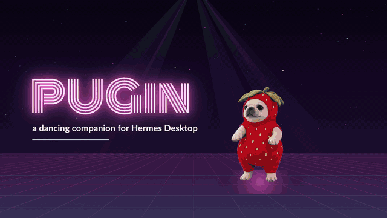
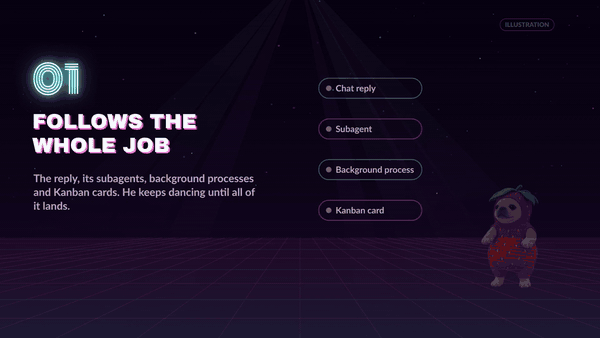
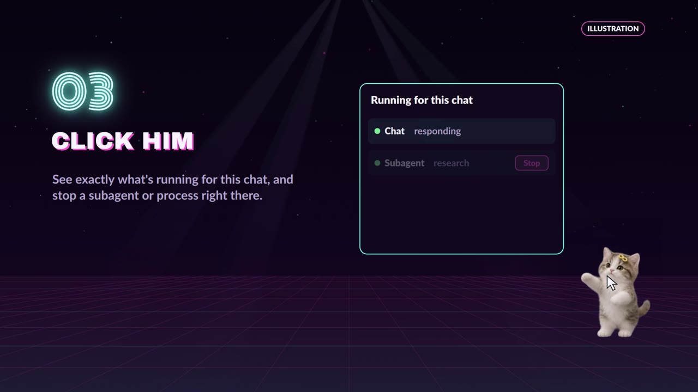
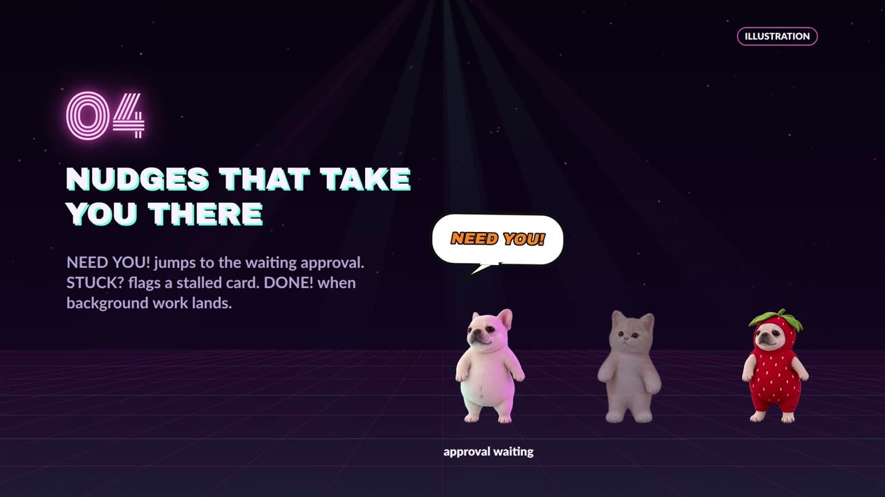
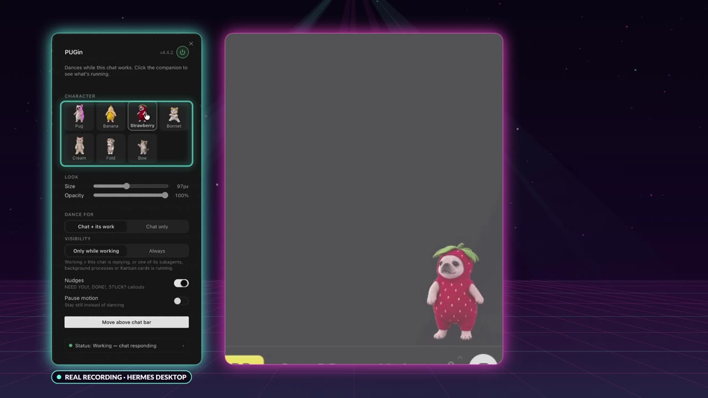

# PUGin

**A dancing companion for Hermes Desktop. He beams in when the chat you're looking at starts working, and beams out when all of its work is done.**



▶ **[Watch the 45-second demo video](https://github.com/ShawnCRMer/hermes-pugin/releases/download/v4.4.2/PUGin-demo.mp4)**

## Why

The status-bar pulse in Hermes tells you the reply is still streaming. It doesn't tell you that the chat started three subagents, a background build and a Kanban card, and that those are still running after the reply ends.

PUGin keeps track of the whole job for the chat you're viewing. While any of it is running, he dances in the corner. When the last piece finishes, he beams back up. One look tells you whether this chat is still busy, without opening four panels.

## What it does



### Follows the whole job

PUGin counts as "working":

- **The chat itself**: the reply that's streaming, running tools, or thinking.
- **Its subagents and background processes**, started from this chat.
- **Its Kanban tasks**: cards this chat created (and linked child cards).

He keeps dancing after the reply ends while any of that work is still running.

### Only your chat

Work from other chats never makes him dance. Switch to another chat and PUGin follows that one instead. If you only want the reply itself, switch **Dance for** to **Chat only**.

If one of the sources can't be read (for example, an older Hermes without Kanban), PUGin doesn't guess. It leaves it out and Settings says why.

### Click him



Click PUGin for a list of exactly what's running for this chat: the reply, each subagent, each background process and each Kanban card, with how long it's been going. Subagents and processes have a **Stop** button (with a confirm step).

### Nudges that take you there



- **NEED YOU!** when this chat is waiting on an approval or an answer, or one of its Kanban cards is blocked. Click the callout to go to it.
- **STUCK?** when a subagent hasn't taken a step in 10 minutes, or a Kanban card's heartbeat has gone quiet or run past its time limit. He slows down and sweats. Click to go look.
- **DONE!** with confetti when background work for this chat lands.

Nudges can be turned off.

### Seven characters



Pug, Banana Pug, Strawberry Pug, Bonnet Kitten, Cream Kitten, Fold Kitten and Bow Kitten. Right-click PUGin (or click **PUGin** in the status bar) to choose one and set:

- **Size** and **opacity**
- **Presence**: only while working (beam in and out), or always visible (stands still when idle)
- **Dance for**: this chat and its work, or the chat only
- **Nudges** on or off
- **Pause motion** (he also follows your system's reduced-motion setting)
- **Move above chat bar** / drag him anywhere. The position is remembered.
- **Turn PUGin off** without uninstalling

## Install

From Hermes Desktop: **Capabilities → Plugins**, search for **PUGin**, then **Install**.

From the command line:

```sh
hermes plugins install pugin
```

PUGin is one package with two halves. The installer puts the Desktop half on the computer running Hermes Desktop and the small server half on your Hermes backend, including when Desktop is connected to a remote gateway. Enable the plugin when the installer asks. Nothing else to set up: no API keys, no config edits.

## Privacy and what it touches

- **No network calls.** All animations are bundled inside the plugin. Nothing is downloaded at runtime and nothing is sent anywhere. No telemetry.
- **Reads only.** The Desktop half asks Hermes for the focused chat's subagents, processes and pending approvals every 4 seconds while Desktop is open. The server half has one read-only route, `GET /api/plugins/pugin/linked-work`, which opens Hermes's Kanban board databases read-only to find cards that belong to that chat.
- **One action.** The **Stop** button calls Hermes's own interrupt for a subagent or kill for a background process, only when you click it and confirm.
- **Stores** your settings (character, size, position and so on) in the Desktop plugin storage Hermes provides. No other files are written.
- No shell commands, no credentials, no background services after Desktop is closed.

## Compatibility

- Hermes Agent **0.23.0** or newer, with **Hermes Desktop**.
- Works with Desktop on the same machine as Hermes or connected to a remote gateway.
- Kanban tracking needs a Hermes with the Kanban board. Without it, PUGin still follows the chat, its subagents and its processes.

## License

MIT © 2026 Shawn Cleta. The character animations are original, created by the author, and covered by the same license.
